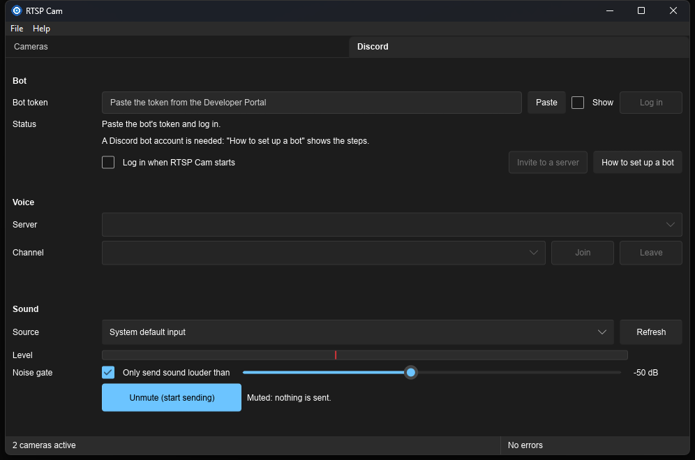

# 20 — Progress: Discord Tab, phases D0–D4

Date: 2026-10-12. Branch `feat/audio-tab`. Builds the first release of the plan in
[19](19-discord-tab-plan.md) (D0–D4): the `rtspcam-audio` and `rtspcam-discord` crates,
`discord.json`, and the Discord tab. **Nothing has been tried against Discord yet**: there was
no bot token or test server in this session. §5 lists what still needs a person.

## D0 results

The spike was done in place rather than as a throwaway example: the parts that need no Discord
account were measured, the rest is in §5.

| Question (19 §4 D0) | Answer |
|---|---|
| Versions | songbird **0.6.1** (pinned `=0.6.1`), serenity **0.12.5** (songbird 0.6 asks for serenity 0.12), cpal **0.18.2**, rubato **0.16** (the version songbird uses, so it is built once). |
| 1. DAVE handshake | **Not checked** (needs a bot token and listeners). songbird 0.6.1 depends on `davey` 0.1 and maps close code 4017 (`DaveProtocolRequired`); the tab shows it with the "needs an update" hint. |
| 2. Microphone capture | Works on Windows (WASAPI): a USB webcam microphone and a headset, 48 kHz stereo `f32`, ~49 blocks/s. `cargo run -p rtspcam-audio --example audio_check [id]` lists devices and measures 2 s. Latency by ear not checked. |
| 3. Live PCM into songbird | `RawAdapter` over a `Read` of interleaved LE `f32` (`QueueReader`). Read from the source: songbird's raw codec reads exactly 20 ms per packet (`read_boxed_slice`), and a 0-byte read ends the track, so the reader returns **2.5 ms of silence** when the queue is empty (short, so sound arriving just after an underrun isn't delayed much). Tested without a network. |
| 4. WASAPI loopback | **Works with cpal 0.18**: an output device opened as an input records what it plays (cpal sets `AUDCLNT_STREAMFLAGS_LOOPBACK`). Checked by playing a tone with `Playback` while recording the same output. WASAPI delivers **no blocks while the output is silent**; the reader's silence covers that. No `rtspcam-platform` code needed; `loopback_supported()` checks that the host is WASAPI. |
| 5. Receive | Not done (D5). |
| 6. Build cost | See below. |
| 7. Intents | Only `GUILDS` and `GUILD_VOICE_STATES` (neither privileged). Servers and channels come from serenity's cache. Not yet confirmed against a live gateway. |
| 8. COM | cpal 0.18 initializes COM as **STA** (and accepts `RPC_E_CHANGED_MODE`), the same mode winit needs, so the clash the plan feared doesn't happen with this version. Rule 3 is kept anyway: devices are listed on an `audio-devices` thread and opened on the bot's runtime (`spawn_blocking`), never on the UI thread. |

**Build cost** (Windows, clean release build of `rtspcam-app`, same machine):

| | Before (v1.6.0) | After |
|---|---|---|
| `rtspcam.exe` | 21.7 MB | 40.1 MB (+18.4 MB) |
| Clean release build | 193 s | 349 s |
| Crates in `Cargo.lock` | 711 | 932 (+221) |

- **No crate the camera code uses changed version.** The lock diff only adds crates; 20 of
  them are second copies of crates already present at another version (`rand` 0.8, `syn` 1,
  `windows` 0.48 through `loom` (only built under `cfg(loom)`), `parking_lot` 0.11, ...).
  tokio, rustls, `windows` 0.62 and the rest are unchanged.
- **libopus needs CMake** (`libopus_sys` builds the bundled source with it). GitHub's runners
  have CMake; locally, Visual Studio's C++ workload ships one, which the `cmake` crate finds
  through the `CMAKE` variable. README lists it.
- **C runtime clash, fixed.** The workspace links the C runtime statically (`+crt-static`),
  but CMake built libopus with `/MD`, so linking warned `LNK4098: defaultlib 'MSVCRT'
  conflicts`. `.cargo/config.toml` now passes a toolchain file
  (`tools/cmake/msvc-static-crt.cmake`) that sets `CMAKE_MSVC_RUNTIME_LIBRARY` and libopus's own
  `OPUS_STATIC_RUNTIME`; the warnings are gone.
- `.cargo/config.toml` also sets `LIBOPUS_BUNDLED`/`LIBOPUS_STATIC`, so libopus is linked
  statically on every OS (no runtime Opus package for `.deb`/`.rpm`).

The binary nearly doubles and the clean build takes 1.8× as long; most of it is serenity's and
songbird's dependency tree (rustls/reqwest/tungstenite a second time over, symphonia, the DAVE
crypto). Go anyway: it is a one-time download cost and the camera code is untouched; the
`discord` cargo feature (§2) gives a camera-only build when that matters. Trimming serenity's
features further is possible later.

## 1. What was done

### D1 `rtspcam-audio`

- `Block`: 20 ms of 48 kHz stereo `f32` (1 920 samples), boxed array.
- `BlockQueue`: `Mutex<VecDeque<Block>>`; above the lag limit (200 ms) it drops the **oldest**
  blocks and counts them. A mutex rather than a lock-free ring: both sides only move a pointer
  under it, and an SPSC ring can't drop from the producer side.
- `Converter`: device format → blocks. Mono to both channels, more than two channels → the
  first two, other rates through rubato's `FftFixedIn` in 10 ms chunks.
- `Gate`: per block, block peak against the threshold (default −50 dBFS), 200 ms hold, 5 ms
  linear fade (no clicks). `Level`: peak and RMS in dBFS, floor −90.
- `devices()`: inputs then outputs, sorted by name, with ids `input:<cpal id>` /
  `output:<cpal id>` (cpal 0.18 has stable `DeviceId`s, so two devices with the same name are
  told apart) and `default`.
- `Capture` (any sample format cpal offers, converted to `f32`), `Playback` (resamples and maps
  to the output's channels; silence on underrun; used by D5). Overruns and device-changed
  notices only go to the log; other stream errors are reported once (device loss).
- 24 tests without hardware (format conversion, resample length and level, gate timing, lag
  drop, playback mapping).

### D2 `rtspcam-discord`

- `DiscordBot`: the handle. `new` starts nothing; `login` builds a 2-worker runtime with
  `discord` threads; `logout` stops it on a `discord-stop` thread (3 s limit); `shutdown(limit)`
  does the same synchronously for quitting. Options (input, mute, gate) set while logged out
  are kept for the next login. A generation counter stops an old session's late status
  updates from overwriting a newer one.
- `Session`: the state machine behind `BotStatus` (`Off`, `LoggingIn`, `Online { user,
  invite_url, servers, voice, input, muted, notice }`, `Failed { reason, hint }`). It talks to a
  `Backend` trait; `SerenityBackend` (`backend.rs`) is the only code that uses serenity or
  songbird. The capture opens on join and closes on leave (no microphone in use while the bot
  only idles online).
- Rejoin after a dropped connection with 1, 2, 5, 10, 30 s backoff (`BotError::worth_retrying`
  decides); kicks (4014, 4022, or the bot's voice state going to no channel), DAVE refusals
  (4017) and bad requests are not retried and show a notice with a hint. A moved bot follows
  the move.
- Mute uses songbird's `Call::mute`: the bot shows as muted in the channel and songbird sends
  its five silence frames first (D2 step 6, read from songbird's mixer: it does this itself
  whenever the mix goes silent). The capture keeps running while muted so the meter still
  shows the level; unmuting clears the queue so old sound isn't sent.
- The capture callback only touches atomics (mute, gate settings, level) and the queue.
- A failed or unplugged device is retried every 3 s while in a channel; changing the source in
  a channel swaps the capture without leaving.
- Login checks the token with a REST call first (`get_current_user`), so a bad token fails at
  once; the application id for the invite link comes from `get_current_application_info`.
  Invite permissions 3146752 (View Channel, Connect, Speak).
- Token: a `Secret` until handed to serenity, which skips it in its `#[instrument]`s. At
  `info`/`debug`/`trace` the log filter now caps `serenity` at `warn` and `songbird` at `info`
  (`rtspcam-core/src/logging.rs`), since at debug they print whole gateway payloads.
  `RTSPCAM_LOG` still overrides.
- 22 tests with a fake backend and fake inputs (login, bad token, join/leave, rejoin on ready,
  backoff, DAVE, kick, device retry, source swap, gateway loss, stale status).

### D3 config

- `rtspcam-core`: `ConfigStore` became `JsonStore<T: Document>` (`ConfigStore` is now an alias
  for `JsonStore<Config>`, so no caller changed); migrations take the version and steps per
  document. `discord.json` is `DiscordStore = JsonStore<DiscordSettings>`, with its own
  `version` 1, `.bak`, atomic save and watcher. `config.json`'s schema and version are
  unchanged.
- `DiscordSettings`: as in 19 §4 D3 (ids as strings), plus unknown fields kept. `muted`
  defaults to `true`. Validation: threshold −90..0, numeric ids, non-empty input, readable
  token.
- An unreadable `discord.json` doesn't stop the app: the tab shows the error, uses defaults,
  and doesn't overwrite the file.
- Headless: logs in when `auto_login` is on and watches `discord.json`; source, mute, gate and
  token changes apply live (`src/discord.rs`, `apply_change`). The window does the same.
- Shutdown order in both modes: bot, then cameras.

### D4 the tab

- `app.slint`: a `TabWidget` with **Cameras** (the old content, unchanged) and **Discord**;
  menu bar and status bar outside. The open tab is saved as `settings.window_tab` in
  `config.json` (an extra field, so no schema change) when the app quits.
- `ui/discord.slint` + `src/ui/discord_tab.rs`: Bot (token with Paste/Show, Log in/out,
  status and hint, auto-login, Invite, setup help link), Voice (server and channel pickers,
  Join/Leave, voice line with lag and skipped sound, notice), Sound (source with Refresh,
  level meter with the gate threshold, gate checkbox and slider, a big Mute button).
- A 50 ms timer reads the status and the meter only while the bot runs. Devices are listed on
  "Log in" and "Refresh". Slider moves are saved after 0.5 s of quiet.
- Tray: "Discord: Mute"/"Unmute" while in a channel.
- Leaving with **Leave** clears `last_channel`, so the next login doesn't rejoin.
- Manual page: [manual/discord.md](manual/discord.md) (bot setup including TEAS's "make it
  private" advice, use, troubleshooting).

## 2. Decisions beyond the plan

- **`discord` cargo feature** on `rtspcam-app`, on by default. `--no-default-features` builds
  the camera app without Discord, audio or CMake; the tab then only says so.
- **`rtspcam-platform::desktop::open_url`** for the invite and help links (Explorer, `xdg-open`,
  `open`).
- **Status and meter are polled** from a UI timer rather than pushed with
  `invoke_from_event_loop`: a `watch` channel plus atomics, read at most 20 times a second and
  only while the bot runs.
- **The input opens on join, not on login**, so logging in alone never opens a microphone.
- **Plain mutex queue** instead of `ringbuf` (see D1).
- CI and the release workflow install `libasound2-dev` on Linux (cpal links ALSA); the `.rpm`
  requires `alsa-lib`. The `.deb` gets it through `$auto`.

## 3. Tests run

- `cargo test --workspace --locked`: all pass on Windows (including 24 new in
  `rtspcam-audio`, 22 in `rtspcam-discord`, 7 new in `rtspcam-core`).
- `cargo clippy --workspace --all-targets --locked -D warnings`, the `rtspcam-app
  --no-default-features` build and `tools/ci/check-os-cfg.sh`: clean.
- Hardware, Windows: capture from two microphones, playback of a tone, loopback of an output.
- The release app on Windows: the Cameras tab works as before with a live camera; the Discord
  tab draws; **Refresh** lists the devices; a made-up token reached Discord and came back as
  "Discord refused the token" with its hint; `discord.json` held the token DPAPI-sealed and the
  log didn't contain it; quitting was immediate.

## 4. Not done (later phases)

D5 (receive), D6 (auto-join per server, follow a user, stage speaker requests, leave server),
D7 (camera audio), most of D8 (macOS `Info.plist`). Stage
channels are listed and can be joined, but nothing asks to speak yet.

## 5. Not verified (needs a person)

- **Everything against Discord**: login, the server list, joining, the DAVE handshake with
  listeners (no 4017), sound quality and latency by ear, mute/unmute as heard, kick/move,
  rejoin after pulling the network, the invite link, a refused token's message.
- The tab's look in light and dark mode, and at the window's minimum size.
- Linux: ALSA/PipeWire capture, "Monitor of ..." sources, the tab; macOS: anything at run time.
- That serenity/songbird print nothing secret at the capped levels (read from the source only).
- Clean release build on CI's three runners (CMake, ALSA headers).
